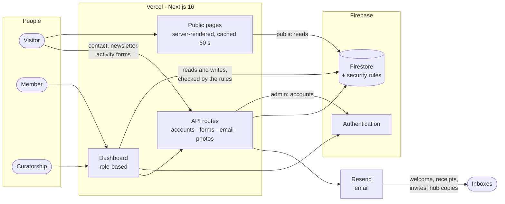
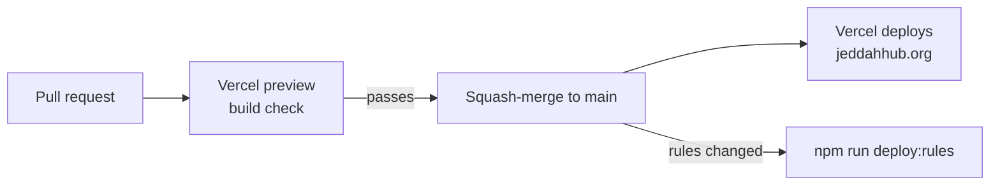

# Jeddah Hub

[](https://nextjs.org)
[](https://react.dev)
[](https://www.typescriptlang.org)
[](https://firebase.google.com)
[](https://vercel.com)
[](https://jeddahhub.org/ar)

The official website of **Jeddah Hub**, my local chapter of the
[World Economic Forum's Global Shapers Community](https://www.globalshapers.org/),
a network of young people driving change in their cities. It is two things in
one Next.js app:

- a **bilingual public website** (English and Arabic, light and dark) that tells
  the hub's story and showcases its initiatives, activities and news, and
- a **role-based dashboard** that Shapers, initiative leads, impact officers and
  the curatorship use to run the hub day to day.

Nothing here is a template or a demo: every feature exists because the hub
needed it.

**Live site:** [jeddahhub.org](https://jeddahhub.org) ·
**How it works (diagrams):** [docs/HOW-IT-WORKS.md](docs/HOW-IT-WORKS.md) ·
**Developer guide:** [docs/DEVELOPMENT.md](docs/DEVELOPMENT.md) ·
**Changelog:** [docs/CHANGELOG.md](docs/CHANGELOG.md)

## Contents

- [At a glance](#at-a-glance)
- [Features](#features)
- [Tech stack](#tech-stack)
- [Getting started](#getting-started)
- [Environment variables](#environment-variables)
- [Scripts](#scripts)
- [Project structure](#project-structure)
- [Testing](#testing)
- [Deployment](#deployment)
- [Security](#security)
- [Privacy](#privacy)
- [Maintainer](#maintainer)

## At a glance



Every permission is enforced twice: in the interface, so people only see what
is relevant to them, and in the **Firestore security rules**
([`firestore.rules`](firestore.rules)), which are the real authorization
boundary and have their own [tests](#testing).

## Features

### Public website

| Page | What it offers |
|---|---|
| **Home** | The hub's story and place in the World Economic Forum network, impact numbers, the current Hub Activities, featured initiatives, our Shapers and partners. |
| **Who We Are** | The current curatorship, active Shapers and alumni, each with a bio in English and Arabic, photo and social links. |
| **Initiatives** | Every project the hub runs or has run, searchable and filterable, with a Spotlight chosen from the dashboard; a detail page per initiative (challenge, goal, impact, key facts, timeline, gallery, team). |
| **Hub Activities** | A page per event, with an optional registration form and an after-event feedback form (star ratings) built by the organisers; answers export to Excel. |
| **News** | Articles by Shapers and curators, with likes, sharing and related stories. |
| **Become a Shaper** | Recruitment page with a live member count, linking to the World Economic Forum's application platform. |
| **Contact** | Message form checked for bots and spam on the server; the hub gets a copy by email and the visitor a receipt in their language. Newsletter signup with a welcome email. |
| **Privacy Policy, Terms of Use** | What is collected and why. |

Also: full right-to-left layout in Arabic, light and dark themes, readable
URLs (`/en/projects/tech-j-shore`, `/ar/news/welcome-to-the-new-website`), a
branded loading screen, and layouts tested at phone, tablet and desktop sizes.

### Member dashboard

| Role | What they can do |
|---|---|
| **Shaper / Alumni** | Manage their profile and password, browse and join initiatives, propose initiatives and Hub Activities, write news posts, sign the Community Charter. |
| **Initiative lead (Lead / Co-Lead)** | Everything a Shaper can, plus run their initiative: edit its content and photos, review join and leave requests, ask for members to be added or removed or to change role (the Curator or Vice Curator approves), export a member report. |
| **Impact Officer** | Manage initiatives and Hub Activities, pick the spotlight and publish posts. |
| **Curator / Vice Curator** | Everything: add and remove members (logins are created automatically with a one-time password, and a lost password is replaced by email), approve proposals and requests, manage every initiative and activity, feature initiatives, Charter sign-off, moderate posts, read contact messages, export the newsletter list. |

## Tech stack

| Area | Technology |
|---|---|
| Framework | [Next.js 16](https://nextjs.org) (App Router), [React 19](https://react.dev), TypeScript |
| Languages | [next-intl](https://next-intl.dev): English and Arabic, right-to-left layout |
| Data and sign-in | [Firebase](https://firebase.google.com) Authentication and Firestore. The browser uses the client SDK; public pages read Firestore over REST with caching; the server uses the Admin SDK for accounts, form submissions and uploads |
| Styling | CSS Modules and a hand-built design system (no UI framework) |
| Email | [Resend](https://resend.com) from the verified `jeddahhub.org` domain, one sender per kind of email |
| Bot protection | Google reCAPTCHA v3 (loaded only when a form is used), [Vercel BotID](https://vercel.com/docs/botid), Vercel Bot Protection |
| Exports | [ExcelJS](https://github.com/exceljs/exceljs) for `.xlsx`, loaded only when a report is downloaded |
| Token checks | [jose](https://github.com/panva/jose) verifies Firebase ID tokens in API routes |
| Hosting | [Vercel](https://vercel.com), server code in the Mumbai region, close to the visitors and the database |

## Getting started

**You need:** Node.js 20 or newer, and a Firebase project with
**Authentication** (Email/Password) and **Firestore** enabled. Java 17 or newer
is only needed to run the security-rules tests.

```bash
npm install
cp .env.example .env.local   # then fill in the values (see below)
npm run dev                  # http://localhost:3000
```

Without the Firebase values the public pages still render, just without live
data.

## Environment variables

Set these in `.env.local` for local work and in the Vercel project for
production. [`.env.example`](.env.example) lists them with notes on where each
value comes from. Never commit real values.

| Variable | Needed for | Notes |
|---|---|---|
| `NEXT_PUBLIC_FIREBASE_API_KEY`, `…_AUTH_DOMAIN`, `…_PROJECT_ID`, `…_STORAGE_BUCKET`, `…_MESSAGING_SENDER_ID`, `…_APP_ID` | Everything | The Firebase web-app settings. Public by design: access is controlled by `firestore.rules`. |
| `FIREBASE_SERVICE_ACCOUNT` | Accounts, forms, uploads | Server only. The service account's JSON key on one line. |
| `NEXT_PUBLIC_RECAPTCHA_SITE_KEY`, `RECAPTCHA_SECRET_KEY` | Public forms, sign-in | Without the secret, the forms refuse every submission rather than skip the check. |
| `RESEND_API_KEY` | Email | Without it, emails are skipped. |
| `NEWSLETTER_EMAIL`, `CONTACT_EMAIL`, `MEMBERS_EMAIL` | Optional | Sender addresses; default to `newsletter@`, `contact@` and `members@jeddahhub.org`. |
| `CONTACT_INBOX` | Optional | Where contact messages and records go; defaults to the hub's inbox. |
| `EMAIL_DAILY_LIMIT` | Optional | Most emails visitors can trigger per day; default 200. |
| `NEXT_PUBLIC_SITE_URL` | Optional | Canonical URL for metadata and the sitemap; default `https://jeddahhub.org`. |

## Scripts

| Command | What it does |
|---|---|
| `npm run dev` | Local development server |
| `npm run build` / `npm run start` | Production build, and serve it locally |
| `npm run lint` | ESLint |
| `npm run typecheck` | TypeScript, no output |
| `npm run check` | Typecheck and lint together; run before every pull request |
| `npm run test:rules` | Tests `firestore.rules` in the Firestore emulator (needs Java 17+) |
| `npm run deploy:rules` | Publishes `firestore.rules` and indexes to Firebase |

## Project structure

```
src/
├── app/
│   ├── [locale]/                # Every page, under /en and /ar
│   │   ├── page.tsx             # Home; other public pages pair a server page.tsx
│   │   ├── …                    #   with an interactive *Client.tsx
│   │   └── dashboard/
│   │       ├── curator/         # Curator / Vice Curator tools (initiatives, roster, members, …)
│   │       ├── impact/          # Impact Officer tools
│   │       └── shaper/          # Pages every member has (profile, projects, charter, …)
│   └── api/                     # Server routes: accounts, invites, forms, photos, checks
├── components/                  # Shared UI (navbar, footer, home sections, form builders)
│   └── dashboard/               # Shared dashboard pieces (search, pickers, banners)
├── context/                     # Auth and theme providers
├── i18n/                        # Language routing
└── lib/                         # Firebase, data loading, security helpers, utilities
    └── emails/                  # Email templates (layout, newsletter, contact, invites)

messages/en.json, ar.json        # Every interface string, in both languages
public/                          # Logos, images, security.txt
tests/firestore-rules/           # Security-rules tests
docs/                            # How it works, developer guide, changelog
firestore.rules                  # The authorization boundary, documented inline
```

The [developer guide](docs/DEVELOPMENT.md) explains where each kind of change
goes and the conventions the code follows.

## Testing

- **Security rules:** `npm run test:rules` starts the Firestore emulator on a
  throwaway `demo-` project and checks who can read and write what: team
  changes, theme colours, photos, posts and likes, Roster requests, private
  collections and roles. Run it whenever `firestore.rules` changes.
- **Code:** `npm run check` (TypeScript and ESLint) must pass; every pull
  request also gets a Vercel preview build.

## Deployment



- **Website:** every merge to `main` deploys to Vercel. `main` is protected:
  changes arrive only through a pull request whose Vercel check passed.
- **Security rules:** after a change to `firestore.rules` is merged and its
  tests pass, `npm run deploy:rules` publishes it. Sign in once first with
  `npx firebase-tools login`.

## Security

- **Authorization** lives in [`firestore.rules`](firestore.rules): only curators
  grant roles, people can only act in their own name, and every request type
  has its own reviewer.
- **Accounts** start with a random one-time password that must be replaced at
  first sign-in. A lost password is replaced by a curator: the new one-time
  password is emailed only to the member and signs them out everywhere.
- **Public forms** go through server routes only: rate limits, bot traps,
  BotID, reCAPTCHA, input checks, a check that the post comes from this site,
  and duplicate protection. Uploads are checked and limited per member.
- **Pages** send a content security policy and the other standard security
  headers; styles built from user data are sanitized, links are limited to
  `http(s)`, and spreadsheet exports neutralize formulas.
- **Secrets** live only in Vercel's environment settings, never in the code.

To report a vulnerability, see [SECURITY.md](.github/SECURITY.md).

## Privacy

Members' names, photos, bios and event sign-ups live in Firestore, not in this
repository; the code contains no one's personal information or credentials.
Public pages only read `public_profiles`, which never holds an email address.
The site's Privacy Policy and Terms of Use describe what is collected and why.

## Maintainer

Built and maintained by **Mohammed Alshawi**
([@The-Dark-Ranger](https://github.com/The-Dark-Ranger)), Curator of Jeddah Hub
2026/2027. Jeddah Hub is part of the
[Global Shapers Community](https://www.globalshapers.org/), an initiative of
the [World Economic Forum](https://www.weforum.org/).

No open-source licence is attached to this repository. Please ask before
reusing the code.
