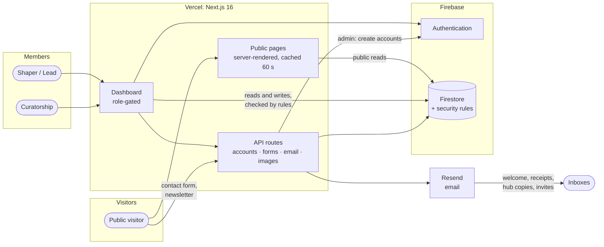
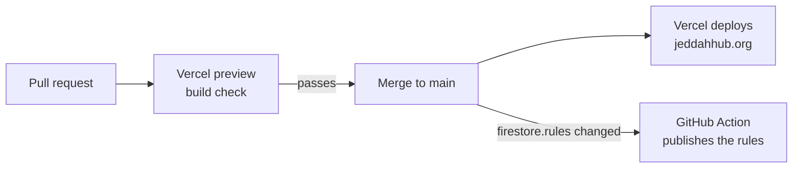

# Jeddah Hub

The official website for **Jeddah Hub**, my local chapter of the [World Economic
Forum's Global Shapers Community](https://www.globalshapers.org/), a network of
young people driving grassroots change in their cities. I built this site to give
our hub a real public presence and a working operations tool at the same time: a
bilingual public website that tells our story and showcases our initiatives, and a
role-gated dashboard our Shapers and curators actually use to run the hub day to
day.

It's a single Next.js application that serves both halves. Nothing here is a
template or a demo: every feature exists because a specific need on the hub came
up and I built a way to handle it.

**Live site:** [jeddahhub.org](https://jeddahhub.org) ·
**How it works, with diagrams:** [docs/HOW-IT-WORKS.md](docs/HOW-IT-WORKS.md)

## At a glance



## What's on the site

### Public pages

- **Home**: the hub's story, our place in the World Economic Forum network,
  impact numbers, the current Hub Activities (in each one's own colour, with
  arrows when there are several), curator-picked featured initiatives, our
  Shapers and partners.
- **Who We Are**: the current curatorship, active Shapers and alumni, each with
  a bio (English and Arabic), photo and social links.
- **Initiatives**: every project the hub runs or has run, searchable and
  filterable by area. A Spotlight card at the top is chosen from the dashboard.
  Each initiative has a detail page (challenge, goal, impact, key facts,
  timeline, gallery and team).
- **Hub Activities & Workshops**: a page per event, with an optional
  registration form and an after-event feedback form (with star ratings) that
  the organisers build themselves. Responses land in the dashboard and export
  to Excel.
- **News**: articles written by Shapers and curators, with likes, sharing and
  related stories.
- **Become a Shaper**: the recruitment page, with a live member count, linking
  to the World Economic Forum's own application platform.
- **Contact**: a message form checked for bots and spam on the server. The hub
  gets a copy by email and the visitor gets a receipt in their language. Plus a
  newsletter signup that keeps each address once and sends a welcome email in
  the visitor's language.
- **Privacy Policy** and **Terms of Use**.

A branded loading screen covers the page on the first visit and on every
reload, so the site never appears half-drawn.

Everything is available in English and Arabic (with full right-to-left layout)
and in light and dark themes. Every URL is a readable name: `/en/projects/tech-j-shore`,
`/ar/news/welcome-to-the-new-website`.

### The dashboard

Every member signs in to one shared dashboard, but what they see depends on
their role:

| Role | What they can do |
|---|---|
| **Shaper / Alumni** | Manage their profile, browse and join initiatives, propose a new initiative or Hub Activity for review, write blog posts, and sign the Community Charter. |
| **Initiative Lead** | Everything a Shaper can, plus manage their own initiative: edit its content and photos, review join requests, request that a member be added or removed, and export a member report. |
| **Curator / Vice Curator** | Full administrative control: add members (their login is created automatically with a one-time password) or remove them, approve proposals and membership requests, manage every initiative and Hub Activity, choose featured and spotlight initiatives, require Charter sign-off and see who signed, moderate posts, read contact messages and export the newsletter list. |
| **Impact Officer** | Manages initiatives and Hub Activities, picks the spotlight and publishes posts, without the curator-only tools (roles, messages, featuring, exports, Charter sign-off). |

Every permission is enforced twice: once in the UI, so people only see what's
relevant to them, and again in **Firestore Security Rules**
([`firestore.rules`](firestore.rules)), which is the actual authorization
boundary. The flows behind each feature are drawn out in
[docs/HOW-IT-WORKS.md](docs/HOW-IT-WORKS.md).

## Tech stack

- **[Next.js 16](https://nextjs.org)** (App Router), React 19 and TypeScript
- **[next-intl](https://next-intl.dev)** for English/Arabic with RTL layout
- **Firebase**: Authentication and Firestore (client SDK in the browser;
  Firestore REST for cached public pages; **Admin SDK** on the server to
  create and remove member accounts, issue one-time passwords, and save
  contact messages and newsletter signups after their checks)
- **CSS Modules**: no UI framework, a hand-built design system
- **[Resend](https://resend.com)** for email, from the verified `jeddahhub.org` domain, with a separate sender for the newsletter, the contact form and member invites
- **Google reCAPTCHA v3** on the public forms, loaded only when a form is used
- **[Vercel BotID](https://vercel.com/docs/botid)**, an invisible bot check on the public forms and the login
- **[ExcelJS](https://github.com/exceljs/exceljs)** for `.xlsx` exports
- **[jose](https://github.com/panva/jose)** to verify Firebase ID tokens in API routes
- Hosted on **[Vercel](https://vercel.com)**

## Project structure

```
src/
├── app/
│   ├── [locale]/            # Every localized route (/en, /ar): public pages
│   │   │                    # (server page.tsx + *Client.tsx) and /dashboard
│   │   └── dashboard/
│   │       ├── curator/     # Curator / Vice Curator pages
│   │       ├── impact/      # Impact Officer pages
│   │       └── shaper/      # Pages shared by every signed-in member
│   └── api/
│       ├── members/         # create-account: logins for new members (Admin SDK)
│       ├── invite/          # invite emails
│       ├── contact/send/    # contact form: checks, save, hub copy + receipt
│       ├── newsletter/subscribe/ # newsletter: checks, save once, welcome email
│       ├── img/ · media/    # cached photo delivery
│       └── verify-recaptcha/ · validate-email/
├── components/              # Shared UI (navbar, footer, home sections,
│   └── dashboard/           #   form builders, search picker, banners, …)
├── context/                 # Auth and theme providers
├── i18n/                    # next-intl routing and config
└── lib/                     # Firebase client, public data loader, shared helpers
    └── emails/              # Email templates: layout + logos, newsletter, contact

messages/
├── en.json                  # Every English string
└── ar.json                  # Its Arabic counterpart, kept in lockstep

docs/HOW-IT-WORKS.md         # Flowcharts of every main flow
docs/CHANGELOG.md            # What changed, newest first
firestore.rules              # The security boundary, documented inline
.github/workflows/           # Deploys firestore.rules when it changes
```

## Getting started

**Prerequisites:** Node.js 20+ and a Firebase project with **Authentication**
(Email/Password) and **Firestore** enabled.

```bash
npm install
cp .env.example .env.local   # then fill in the values
npm run dev                  # http://localhost:3000
```

[`.env.example`](.env.example) lists every setting the site reads and where to
find each value. Without the Firebase values the public pages still render,
but no live data loads.

## Scripts

```bash
npm run dev        # Local dev server
npm run build      # Production build
npm run start      # Serve a production build locally
npm run lint       # ESLint
npm run typecheck  # TypeScript, no output
```

## Deployment



- **Website:** every push to `main` deploys to Vercel automatically. Server
  code runs in Vercel's Mumbai region (`vercel.json`), the closest to our
  visitors and to the Firestore database. The
  environment variables from `.env.example` are set in the Vercel project,
  including `FIREBASE_SERVICE_ACCOUNT` for member account creation.
- **Firestore rules:** the
  [Deploy Firestore Rules](.github/workflows/deploy-firebase-rules.yml)
  workflow publishes `firestore.rules` whenever it changes on `main`. It needs
  two repository secrets, `FIREBASE_SERVICE_ACCOUNT` (a service account JSON
  key with the *Firebase Rules Admin* role) and `FIREBASE_PROJECT_ID`. Until
  they're added the workflow skips itself; rules can also be published by hand
  with `npx firebase-tools deploy --only firestore:rules`.

## Security

- **Authorization** lives in [`firestore.rules`](firestore.rules): roles can
  only be granted by a curator, and names and emails on requests, posts and
  notifications must be the sender's own.
- **Accounts** start with a random one-time password that must be changed at
  first sign-in. The login form adds a honeypot, a minimum fill time, reCAPTCHA
  and a lockout after repeated failures.
- **Public forms** (contact, newsletter, and activity registration and
  feedback) can only be submitted through server routes; the database
  refuses direct writes from browsers. Each route applies rate limits that
  hold across every server instance, a honeypot and minimum fill time,
  Vercel BotID, reCAPTCHA (refusing everything if it isn't configured), input checks and
  duplicate protection before saving or sending anything.
- **Initiative teams**: Lead and Co-Lead rights come only from the
  initiative's `leads` array, which only curators and impact officers can
  change; a lead can change the team one plain member at a time, and asks
  for role changes, which only the Curator or Vice Curator approves.
- **Email** only ever goes to the hub's own inbox or to the address that was
  typed into the form, with per-address limits and a daily budget; everything
  a visitor typed is escaped first. Every member invite is also recorded in
  the hub inbox (never with the password).
- **Links and exports**: only http(s) links are saved or shown, and spreadsheet
  exports neutralise formula-like values.
- **At the edge**: Vercel Bot Protection challenges non-browser traffic, common
  scanner probes (`/.env`, `/wp-admin`, `*.php`, …) are refused, and the
  dashboard, login and API are kept out of search engines.
- **Secrets** (service account, reCAPTCHA and Resend keys) are Vercel
  environment variables only, never in the code.

## A note on privacy

Shapers' names, photos, bios and event sign-ups live in Firestore, not in this
repository; the code contains no one's private information or
credentials. Public pages only ever read `public_profiles`,
which never contains an email address. What each role can see and do is
governed by `firestore.rules`, and the site's Privacy Policy and Terms of Use
describe what is collected and why.

---

Built and maintained by Mohammed Alshawi, Curator of Jeddah Hub 2026/2027, part of the
[Global Shapers Community](https://www.globalshapers.org/), an initiative of
the [World Economic Forum](https://www.weforum.org/).
