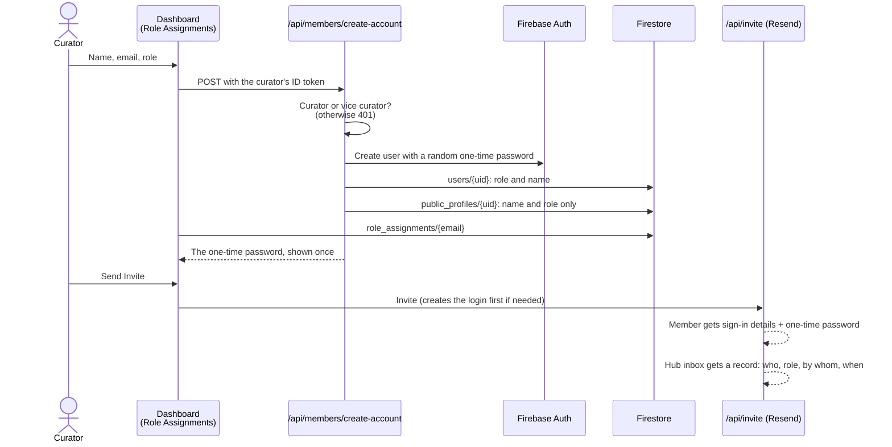
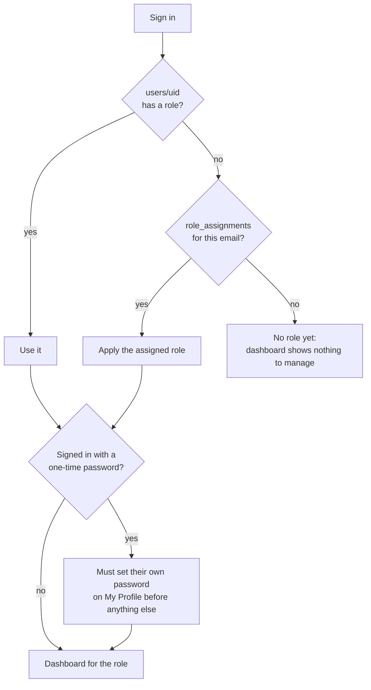
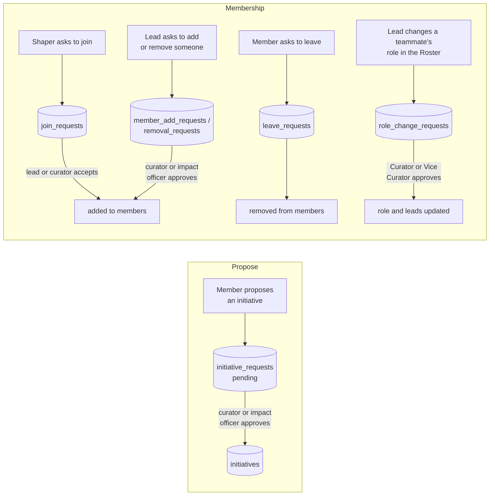
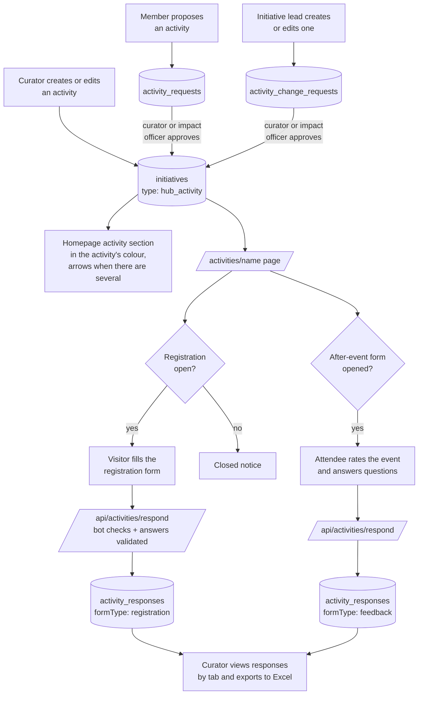
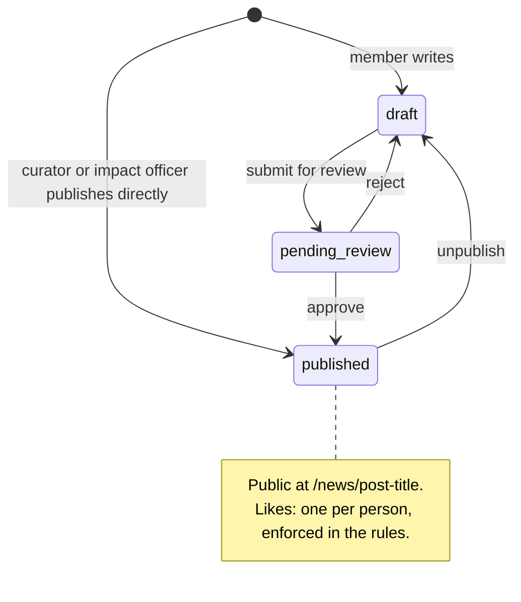
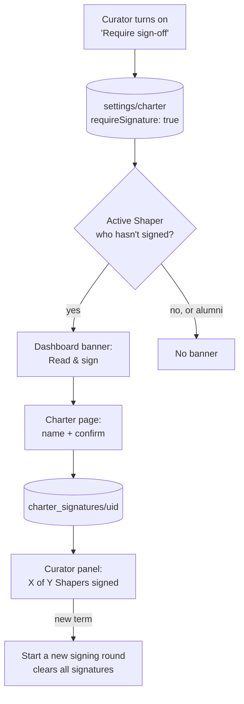
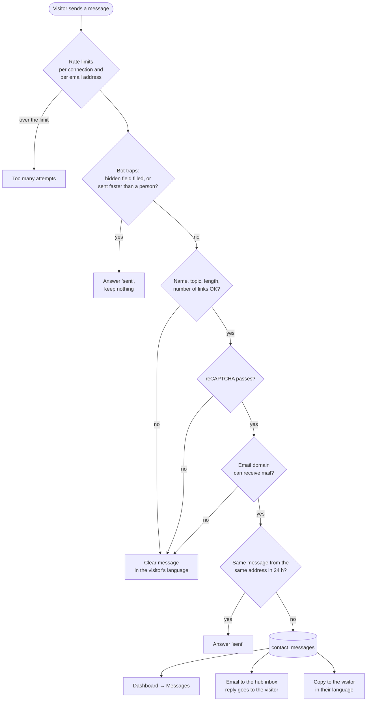
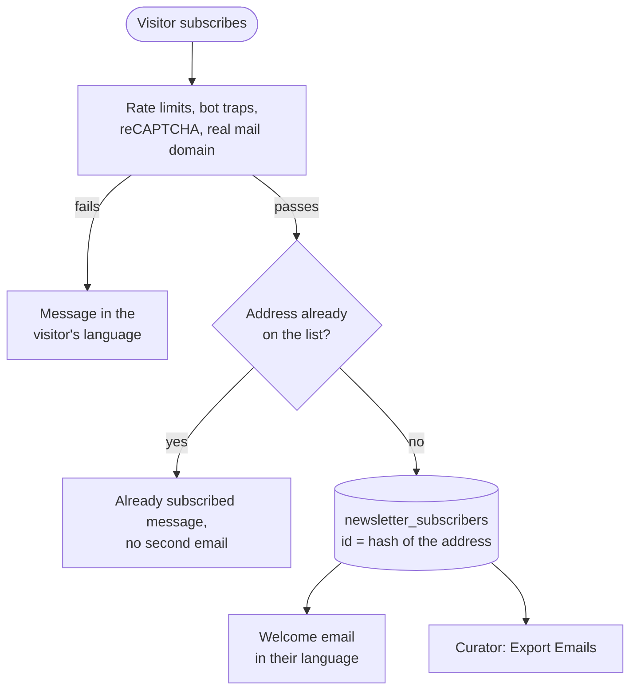
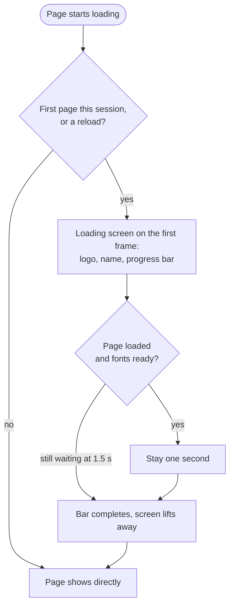
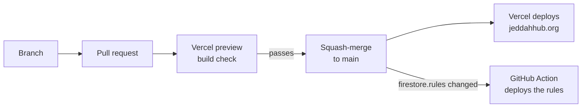

# How it works

A walkthrough of the site's main flows, one diagram each. For the overview,
tech stack and setup, see the [README](../README.md).

- [1. How a public page loads](#1-how-a-public-page-loads)
- [2. Adding a member](#2-adding-a-member)
- [3. Signing in and roles](#3-signing-in-and-roles)
- [4. Initiatives: proposals, joining and leaving](#4-initiatives-proposals-joining-and-leaving)
- [5. Hub Activities: registration and feedback](#5-hub-activities-registration-and-feedback)
- [6. News posts](#6-news-posts)
- [7. Community Charter sign-off](#7-community-charter-sign-off)
- [8. Contact form](#8-contact-form)
- [9. Newsletter signup](#9-newsletter-signup)
- [10. Emails](#10-emails)
- [11. Loading screen](#11-loading-screen)
- [12. Shipping a change](#12-shipping-a-change)
- [Where data lives](#where-data-lives)

---

## 1. How a public page loads

Public pages (Home, Who We Are, Initiatives, News, and each initiative,
activity and post) get their content from the server, inside the page
itself. The browser doesn't have to fetch it after loading, so content
shows immediately on any phone or network.


- [`src/lib/publicData.ts`](../src/lib/publicData.ts) reads the public collections
  without credentials, so [`firestore.rules`](../firestore.rules) still decide what's
  visible. Results are cached for 60 seconds: dashboard edits appear on public pages
  within a minute.
- Photos stored inline in a document are served by
  [`/api/img`](../src/app/api/img/%5Bcollection%5D/%5Bid%5D/%5Bfield%5D/route.ts).
  Their URL carries a hash of the photo, so a changed photo gets a new URL.
- If the server can't reach Firestore, each page falls back to loading the
  same data in the browser.

## 2. Adding a member

A curator adds someone in **Role Assignments**. The server creates their
login and lists them on Who We Are straight away.



- Account creation needs admin rights, so it runs on the server with the
  `FIREBASE_SERVICE_ACCOUNT` key (a Vercel environment variable, never in the repo).
- Every new login gets its own random one-time password (`Tmp-XXXX-XXXX-XXXX`).
  It is shown to the curator once and never stored. **Send Invite** and
  **New one-time password** issue a fresh one, but only for someone who has
  never signed in; anyone who has keeps their own password.
- Removing a **pending** assignment also deletes the unused login and the
  public listing, but only if the person has never signed in.
- A note containing **"Incoming"** (e.g. "Incoming Shaper") keeps the member
  off Who We Are, the homepage and the member counts until their first
  sign-in, which lists them automatically. Until then they have no public
  profile at all, so the database's public API has nothing to show either.
- A member's own password must be at least 8 characters. Someone who has
  lost theirs (including members who have already signed in) gets a new
  one-time password from **Role Assignments → Members → New password**: it
  is emailed only to them (the curator never sees it), signs them out of
  every device, and must be replaced at their next sign-in. Only the
  Curator can do this for a curator's account; nobody for their own.
- **Alumni** in Pending can be **dismissed**: set aside in a collapsible
  *Dismissed Alumni* section to review later, where a curator can still send
  an invite, restore them to Pending, or remove them.
- **Send Invite** emails the member their sign-in address and a fresh
  one-time password (creating their login first if needed), in the
  curator's dashboard language.
- **Members** (below Role Assignments) lists everyone with an account. Shaper
  and Alumni switch with one click; **Remove** (click, then click again to
  confirm) deletes the member everywhere: login, profiles, role assignment,
  charter signature, initiative teams and open requests. Nobody can remove
  themselves, and only the Curator can remove a curator.

## 3. Signing in and roles



| Role | Can |
|---|---|
| Shaper / Alumni | Edit their profile, join or leave initiatives, propose initiatives and activities, write posts, sign the Charter |
| Initiative lead | Everything above, plus edit their own initiative, handle its join, add and remove requests, and ask for teammates' role changes in the Roster |
| Impact Officer | Manage initiatives and activities, publish posts, pick the spotlight |
| Curator / Vice Curator | Everything: roles and accounts, featured initiatives, messages, exports, Charter sign-off |

Each permission is enforced in the dashboard **and** in `firestore.rules`.
The rules are the real boundary: a member can never give themselves any role
or change it (only a curator can), can only edit their own profile fields, and
only the Curator can change a curator's record or make someone a curator.

## 4. Initiatives: proposals, joining and leaving



Team roles are **Member**, **Lead** and **Co-Lead** (picked from a list).
Leads and Co-Leads have the same rights: their uid is in the initiative's
`leads` array, which is what `firestore.rules` checks. A lead can change
the team only one person at a time: accept a join request (adding a plain
Member) or approve a leave, never removing another lead or co-lead. Adding
leads, or several people at once, stays with curators and impact officers.

In the **Roster**, curators change anyone's team role directly. Leads see
only the teams they lead; a role they pick there (never their own) becomes a
`role_change_requests` entry that only the Curator or Vice Curator can
approve, which then updates the role and the `leads` array together.

On the public Initiatives page, curators **feature** up to 3 initiatives on the
homepage. Curators and impact officers put one in the **Spotlight** card.

## 5. Hub Activities: registration and feedback



Each activity has two forms built with the same editor: **Registration**
(before the event) and **After the event**. The after-event form starts closed
and only appears on the activity page once a curator clicks **Open feedback**.
It starts with three editable questions, including a 1 to 5 star rating; the
responses window shows each rating question's average.

Responses only reach the database through
[`/api/activities/respond`](../src/app/api/activities/respond/route.ts): rate
limits, a hidden bot-trap field and minimum fill time, Vercel BotID, reCAPTCHA, a check
that the activity and form are on and open, every answer checked against
that form's own questions (type, options, 1 to 5 ratings, lengths, required
ones), and one response per email per form.

## 6. News posts



## 7. Community Charter sign-off

The Charter page reproduces the hub's official Google Form word for word.
Members confirm it the same way the form asks: their name plus *"I confirm
compliance with Community Charter"*.



## 8. Contact form

Visitors can't write to the database themselves (`firestore.rules` refuses it),
so every message goes through one server route,
[`/api/contact/send`](../src/app/api/contact/send/route.ts), which checks it
before anything is saved or emailed.



- The checks: a hidden "website" field and a minimum fill time catch simple bots;
  the name can't contain links or `<` `>`; the topic must be one of the five on the
  form; the message must be 10 to 5,000 characters with at most 3 links;
  reCAPTCHA must pass (a missing key refuses everything rather than letting
  messages through).
- The visitor's copy is limited per address, so the form can't be used to send
  mail to someone else.

## 9. Newsletter signup

Same idea: [`/api/newsletter/subscribe`](../src/app/api/newsletter/subscribe/route.ts)
is the only way onto the list, and each address is kept once.



The record's id is a hash of the lowercased address, and the save fails if
that id already exists, so even two signups at the same moment end up as one.

## 10. Emails

All email is sent through [Resend](https://resend.com) from the verified
`jeddahhub.org` domain. Each kind of email has its own module and sender.

```mermaid
flowchart LR
    subgraph Site["Server routes"]
        NS[/api/newsletter/subscribe/]
        CS[/api/contact/send/]
        IN[/api/invite/]
    end
    subgraph Templates["src/lib/emails"]
        NL[newsletter.ts<br/>welcome]
        CT[contact.ts<br/>hub copy + visitor copy]
        LY[layout.ts<br/>header with both logos,<br/>footer, EN/AR, RTL]
    end
    NS --> NL
    CS --> CT
    IN --> MB[invite email]
    NL --> LY
    CT --> LY
    LY --> SE[email.ts<br/>sendEmail]
    MB --> SE
    SE --> RS[Resend]
    RS -->|newsletter@| SUB([Subscriber])
    RS -->|contact@| HUBI([Hub inbox])
    RS -->|contact@| VIS([Visitor])
    RS -->|members@| MEM([New member])
```

| Email | Sender | Language | Replies go to |
|---|---|---|---|
| Newsletter welcome | `newsletter@` | The site language the visitor used | Hub inbox |
| Contact: hub copy | `contact@` | English (notes when the visitor wrote in Arabic) | The visitor |
| Contact: visitor's copy | `contact@` | The site language the visitor used | Hub inbox |
| Member invite | `members@` | The curator's dashboard language | Hub inbox |
| Invite record | `members@` | English, to the hub inbox; never contains the password | n/a |

- Every email has a plain-text version, and the welcome email has a
  `List-Unsubscribe` header.
- The Jeddah Hub and World Economic Forum logos travel **inside** each email as
  inline images ([`logos.ts`](../src/lib/emails/logos.ts)), not as links to the
  site, so email apps always show them and they don't appear as separate
  downloadable attachments in most apps.
- Anything a visitor typed is escaped before it goes into an email, and
  subjects are always a single line. Addresses with commas, angle brackets
  or quotes are refused, so one address can never become several.
- Limits that hold across every server instance live in the `rate_limits`
  collection (hashed keys, no IPs or emails stored, browsers can't access
  it): per visitor and per address per day, plus a daily budget for the
  emails visitors can trigger (`EMAIL_DAILY_LIMIT`, default 200).

## 11. Loading screen

A branded loading screen covers the page on a visitor's first page in a
session and on every full reload, so the site never appears half-drawn. It
uses the site's theme: light, or dark when the visitor chose dark or their
device prefers it.



The decision, and the theme, are settled by a tiny script before the first
paint ([`initScripts.ts`](../src/lib/initScripts.ts)), so the screen never
flashes in late or in the wrong colours. Only the logo for that theme is
downloaded. Visitors who prefer reduced motion get a still version that simply
fades.

## 12. Shipping a change



The rules workflow needs the `FIREBASE_SERVICE_ACCOUNT` and `FIREBASE_PROJECT_ID`
repository secrets. Without them it skips itself, and rules are published by hand
with `npx firebase-tools deploy --only firestore:rules`.

---

## Where data lives

| Collection | What | Who can read |
|---|---|---|
| `initiatives` | Initiatives and Hub Activities (`type: hub_activity`) | Everyone |
| `public_profiles` | Name, Arabic name, photo, bios, socials, role. **Never email.** | Everyone |
| `users` | Full member record, including email and the real role | The member, curators, impact officers |
| `role_assignments` | Pending roles, keyed by email | The invitee, curators, impact officers |
| `blogs` | News posts | Everyone if published, otherwise the author and reviewers |
| `media` | Uploaded photos, written only by `POST /api/media` (a real JPEG under 1 MB, a daily limit per member) and served by `/api/media/<id>` | Everyone, one photo at a time by its id; nobody can list them |
| `activity_responses` | Registration and after-event answers (`formType`), written only by the server after its checks | Curators, impact officers |
| `rate_limits` | Server-side counters for the public forms and email (hashed keys) | Nobody (server only) |
| `contact_messages`, `newsletter_subscribers` | Inbound messages and sign-ups, written only by the server after its checks | Curators |
| `settings`, `charter_signatures` | Charter sign-off switch and signatures | Members / curators and impact officers |
| `*_requests`, `notifications` | Proposals and membership requests | The requester and whoever reviews them |

The authoritative version, with every condition explained, is
[`firestore.rules`](../firestore.rules).
