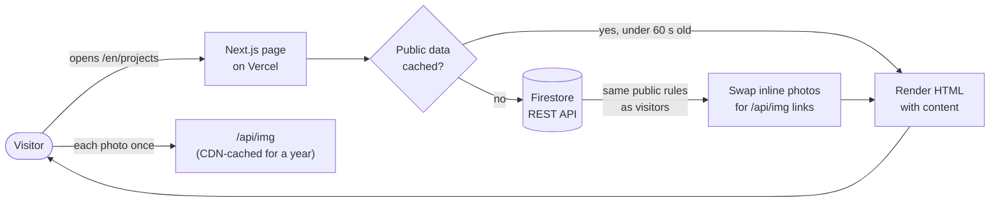
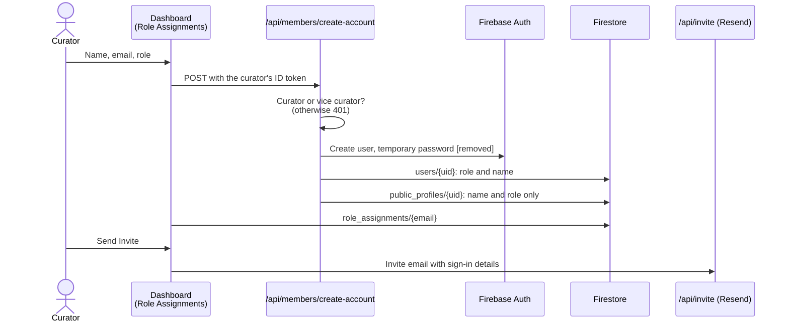
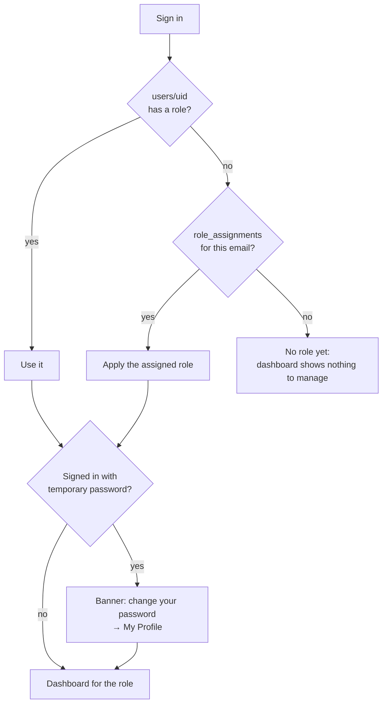
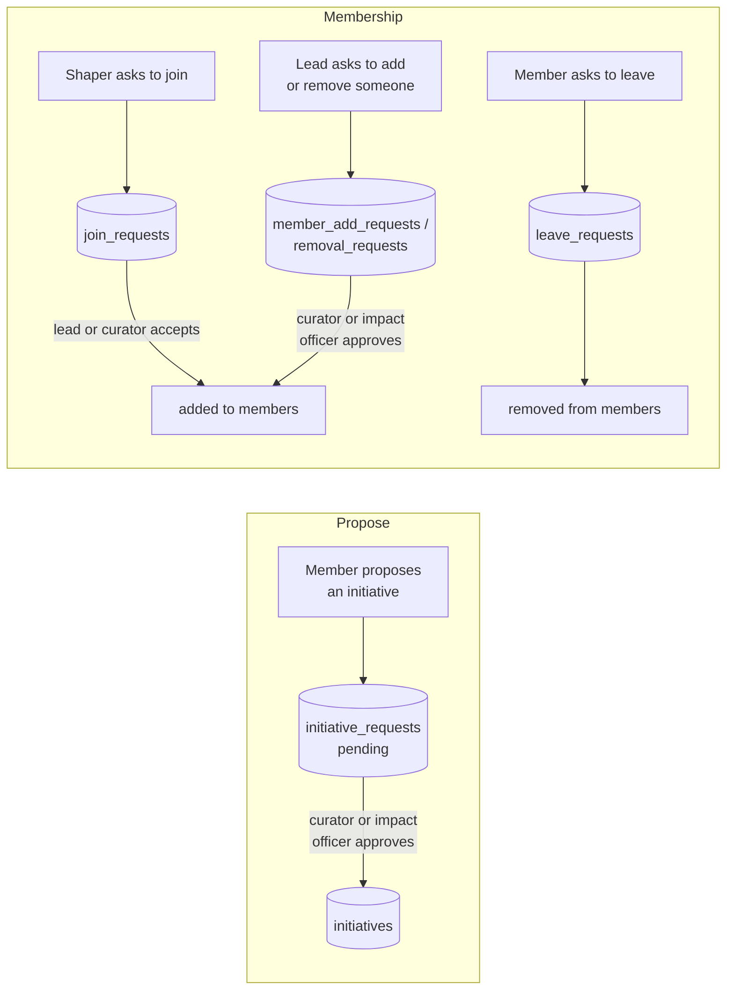
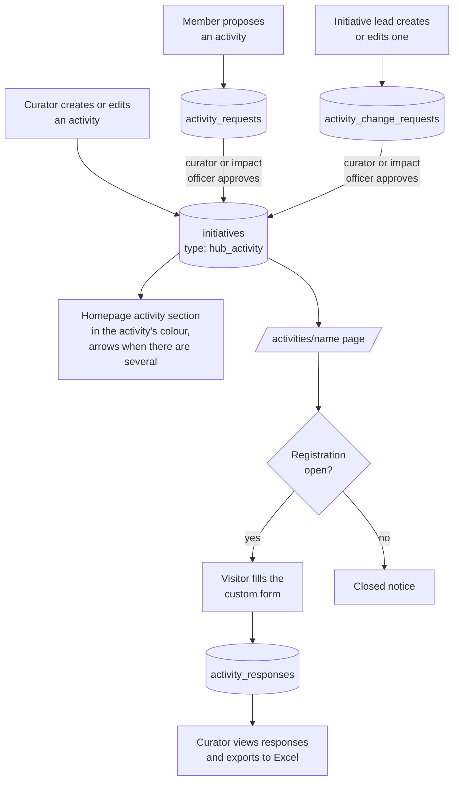
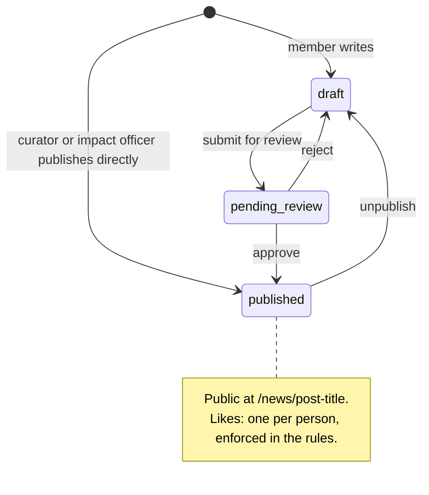
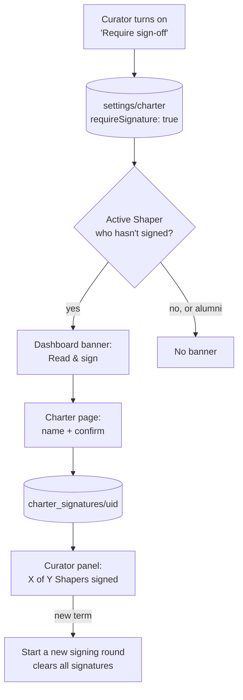
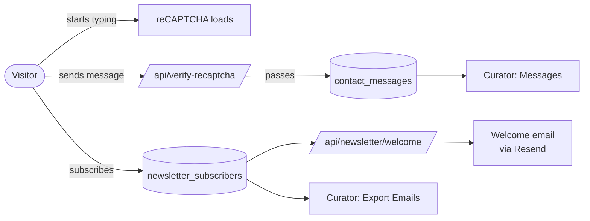
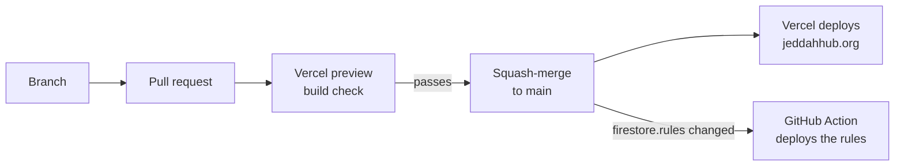

# How it works

A walkthrough of the site's main flows, one diagram each. For the overview,
tech stack and setup, see the [README](../README.md).

- [1. How a public page loads](#1-how-a-public-page-loads)
- [2. Adding a member](#2-adding-a-member)
- [3. Signing in and roles](#3-signing-in-and-roles)
- [4. Initiatives: proposals, joining and leaving](#4-initiatives-proposals-joining-and-leaving)
- [5. Hub Activities and registration](#5-hub-activities-and-registration)
- [6. News posts](#6-news-posts)
- [7. Community Charter sign-off](#7-community-charter-sign-off)
- [8. Contact form and newsletter](#8-contact-form-and-newsletter)
- [9. Shipping a change](#9-shipping-a-change)
- [Where data lives](#where-data-lives)

---

## 1. How a public page loads

Public pages (Home, Who We Are, Initiatives, News, and each initiative,
activity and post) get their content from the server, inside the page
itself. The browser doesn't have to fetch it after loading, so content
shows immediately on any phone or network.

- [`src/lib/publicData.ts`](../src/lib/publicData.ts) reads the public collections
  without credentials, so [`firestore.rules`](../firestore.rules) still decide what's
  visible. Results are cached for 60 seconds: dashboard edits appear on public pages
  within a minute.
- Photos stored inline in a document are served by
  [`/api/img`](../src/app/api/img/%5Bcollection%5D/%5Bid%5D/%5Bfield%5D/route.ts).
  Their URL carries a hash of the photo, so a changed photo gets a new URL.
- If the server can't reach Firestore, each page falls back to loading the
  same data in the browser.

## 2. Adding a member

A curator adds someone in **Role Assignments**. The server creates their
login and lists them on Who We Are straight away.

- Account creation needs admin rights, so it runs on the server with the
  `FIREBASE_SERVICE_ACCOUNT` key (a Vercel environment variable, never in the repo).
- Removing a **pending** assignment also deletes the unused login and the
  public listing, but only if the person has never signed in.

## 3. Signing in and roles

| Role | Can |
|---|---|
| Shaper / Alumni | Edit their profile, join or leave initiatives, propose initiatives and activities, write posts, sign the Charter |
| Initiative lead | Everything above, plus edit their own initiative and handle its join, add and remove requests |
| Impact Officer | Manage initiatives and activities, publish posts, pick the spotlight |
| Curator / Vice Curator | Everything: roles and accounts, featured initiatives, messages, exports, Charter sign-off |

Each permission is enforced in the dashboard **and** in `firestore.rules`.
The rules are the real boundary: a member can never give themselves a higher
role, even by talking to Firestore directly.

## 4. Initiatives: proposals, joining and leaving

On the public Initiatives page, curators **feature** up to 3 initiatives on the
homepage. Curators and impact officers put one in the **Spotlight** card.

## 5. Hub Activities and registration

## 6. News posts

## 7. Community Charter sign-off

The Charter page reproduces the hub's official Google Form word for word.
Members confirm it the same way the form asks: their name plus *"I confirm
compliance with Community Charter"*.

## 8. Contact form and newsletter

reCAPTCHA (around 350 KB) loads only when someone starts using a form, not on
every page.

## 9. Shipping a change

The rules workflow needs the `FIREBASE_SERVICE_ACCOUNT` and `FIREBASE_PROJECT_ID`
repository secrets. Without them it skips itself, and rules are published by hand
with `npx firebase-tools deploy --only firestore:rules`.

---

## Where data lives

| Collection | What | Who can read |
|---|---|---|
| `initiatives` | Initiatives and Hub Activities (`type: hub_activity`) | Everyone |
| `public_profiles` | Name, Arabic name, photo, bios, socials, role. **Never email.** | Everyone |
| `users` | Full member record, including email and the real role | The member, curators, impact officers |
| `role_assignments` | Pending roles, keyed by email | The invitee, curators, impact officers |
| `blogs` | News posts | Everyone if published, otherwise the author and reviewers |
| `media` | Uploaded photos (served by `/api/media`) | Everyone |
| `activity_responses` | Registration form answers | Curators, impact officers |
| `contact_messages`, `newsletter_subscribers` | Inbound messages and sign-ups | Curators |
| `settings`, `charter_signatures` | Charter sign-off switch and signatures | Members / curators and impact officers |
| `*_requests`, `notifications` | Proposals and membership requests | The requester and whoever reviews them |

The authoritative version, with every condition explained, is
[`firestore.rules`](../firestore.rules).
